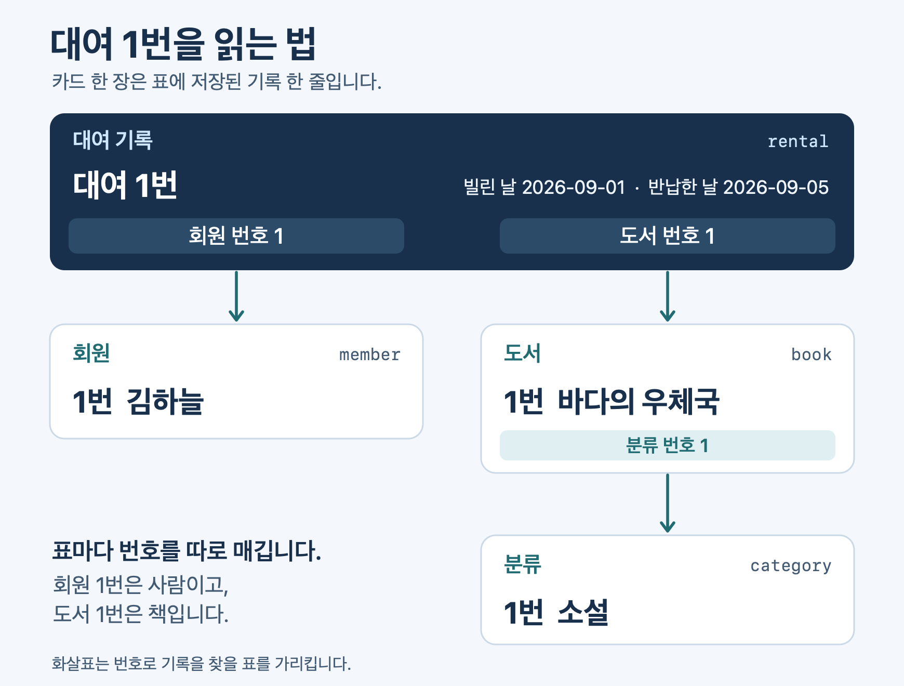

# 도서 대여 데이터베이스

도서관에서 누가 어떤 책을 언제 빌렸는지 저장하고 찾아보는 Codyssey 실습입니다.

**이 프로젝트의 코드는 이름이 `.sql`로 끝나는 파일 네 개입니다.** SQL은 정보를 저장하거나 꺼내는 명령을 적는 언어입니다. **SQLite**는 그 명령을 실행하는 프로그램이고, `library.db`는 정보가 저장된 **데이터베이스(DB)** 파일입니다. 지금 보고 있는 README는 코드와 결과를 읽는 설명서입니다.

[실행 가이드](#실행-가이드) · [그림으로 보는 구조](#그림으로-보는-구조) · [코드와 결과 파일](#코드와-결과-파일) · [동료 평가 확인표](#동료-평가-확인표)

## 실행 가이드

**터미널**은 글자로 명령을 실행하는 창입니다. SQLite 명령줄 프로그램(`sqlite3`)이 설치된 컴퓨터에서 실행합니다. 프로젝트를 내려받은 뒤, `README.md`와 `library-database` 폴더가 함께 보이는 위치에서 시작합니다.

macOS에서는 터미널에 `cd`와 공백 하나를 입력하고, Finder의 해당 폴더를 창에 끌어온 뒤 Enter를 눌러 이동할 수 있습니다.

### 1. 터미널에서 SQLite 열기

```sh
cd library-database
sqlite3 :memory:
```

`sqlite>`가 보이면 SQLite가 열렸습니다. `:memory:`는 SQLite를 닫을 때까지 쓰는 연습용 DB입니다. 같은 명령으로 다시 열면 빈 DB에서 시작합니다.

### 2. SQLite 안에서 파일 실행하기

아래 줄을 `sqlite>`가 보이는 창에 붙여넣습니다. `.read`는 파일을 열어 그 안의 SQL을 차례대로 실행합니다.

```text
.read 01_schema.sql
.read 02_sample_data.sql
.headers on
.mode column
.read 03_queries.sql
```

`01`이 표를 만들고 `02`가 샘플을 넣습니다. `.headers on`은 열 이름을 보이고 `.mode column`은 출력을 표처럼 맞춥니다. 마지막 `03`을 읽으면 조회 결과가 순서대로 나옵니다. 예를 들어 처음 나오는 표는 소설 세 권입니다. [쿼리 번호가 표시된 실제 출력](library-database/results/01_queries.txt)

### 3. 보너스 SQL 실행하기

```text
.read 04_bonus.sql
```

보너스 결과에는 월별 대여 건수, 인기 도서 10권, 2026-11-24 기준 미반납 연체 **2건**이 나옵니다. 이어서 등록되지 않은 회원 번호를 일부러 넣으므로 `FOREIGN KEY constraint failed`가 한 번 표시됩니다. 맨 끝의 `rows_after_rollback`이 `0`이면 실험용 기록을 되돌린 상태입니다. [보너스 실제 출력](library-database/results/02_bonus.txt)

### 4. 연결 상태를 확인하고 SQLite 닫기

```text
PRAGMA foreign_keys;
PRAGMA foreign_key_check;
PRAGMA integrity_check;
.quit
```

`foreign_keys`의 `1`은 연결 규칙 검사가 켜졌다는 뜻입니다. `foreign_key_check`의 위반 행은 0개이고, `integrity_check`의 `ok`는 데이터베이스 검사 통과를 뜻합니다. `.quit`으로 SQLite를 닫습니다.

## 그림으로 보는 구조



**표(테이블)**는 엑셀 표처럼 기록을 가로줄과 세로칸으로 정리한 목록입니다. 가로 한 줄인 **행**은 회원 한 명이나 대여 한 건을 뜻합니다. 세로 한 줄인 **열**에는 이름이나 대여일처럼 한 종류의 값이 모입니다.

그림에서 대여 1번에는 회원 번호와 도서 번호가 들어 있습니다. 대여 표(`rental`)의 회원 번호 칸(`member_id`)이 1이면, 회원 표(`member`)의 1번 행에서 이름 **김하늘**을 찾습니다. 자기 표에서 행을 구별하는 번호가 **기본키(PK)**이고, 다른 표의 행을 가리키는 번호가 **외래키(FK)**입니다. SQL에서 이 번호로 여러 표의 정보를 함께 가져오는 동작을 **조인(JOIN)**이라고 부릅니다.

회원과 책 정보를 각각 한 곳에 두면 책을 빌릴 때마다 이름과 제목을 다시 적을 필요가 없습니다. 한 회원 번호를 여러 대여 기록이 가리킬 수 있는데, 이를 **1:N(일대다)** 관계라고 합니다. 전체 구조는 각 표의 열까지 표시한 관계도에서 볼 수 있습니다. [전체 관계도](library-database/erd.png)

## 코드와 결과 파일

| 파일 | 쉽게 말하면 |
| --- | --- |
| [01_schema.sql](library-database/01_schema.sql) | 회원, 도서, 분류, 대여를 적을 빈 표와 입력 규칙을 만드는 코드입니다. 표와 규칙의 설계를 **스키마**라고 합니다. |
| [02_sample_data.sql](library-database/02_sample_data.sql) | 김하늘 같은 가상의 회원과 도서, 대여 기록을 표에 넣는 코드입니다. |
| [03_queries.sql](library-database/03_queries.sql) | 검색, 표 연결, 건수 계산, 반납 처리와 삭제 등을 확인하는 명령 15개가 들어 있습니다. |
| [04_bonus.sql](library-database/04_bonus.sql) | 같은 질문을 두 방법으로 풀고, 대여 통계를 내고, 잘못된 번호를 넣으면 어떻게 되는지 확인하는 코드입니다. |
| [library.db](library-database/library.db) | 샘플 데이터가 들어 있는 실제 SQLite 파일입니다. |
| [핵심 출력](library-database/results/01_queries.txt) · [보너스 출력](library-database/results/02_bonus.txt) | 코드를 실행했을 때 터미널에 표시된 명령과 결과를 저장한 글 파일입니다. |

## 동료 평가 확인표

Codyssey 미션 「정보를 깔끔하게 정리하는 디지털 서랍장 만들기」의 항목별 코드와 결과를 표에서 확인할 수 있습니다. 내려받은 글 파일에서는 Q 또는 B 번호를 검색하면 됩니다.

| 필수 항목 | 확인된 내용 | 근거 |
| --- | --- | --- |
| 실행 환경 | 로컬 SQLite CLI에서 SQL 파일을 실행 | [실행 가이드](#실행-가이드) |
| 스키마와 관계 | 테이블 4개와 PK 4개, 카테고리→도서·회원→대여·도서→대여의 1:N 관계 3개 | [스키마](library-database/01_schema.sql) · [ERD](library-database/erd.png) |
| 제약조건 | PK 중복, `NOT NULL`, `UNIQUE`, FK 및 날짜 `CHECK` 위반 입력을 거부 | [제약조건 검증](library-database/results/03_verification.txt#L6) |
| 테이블당 최소 10행 | 카테고리 10개, 회원 12명, 도서 15권, 대여 32건 | [INSERT SQL](library-database/02_sample_data.sql) · [SQLite DB](library-database/library.db) · [행 수 검증](library-database/results/03_verification.txt#L2) |
| 쿼리별 실행 기록 | 핵심 SQL 15개와 보너스 SQL의 목적, SQL 본문, 실제 출력 | [핵심 실행 기록](library-database/results/01_queries.txt) · [보너스 실행 기록](library-database/results/02_bonus.txt) |
| 최종 무결성 | 외래키 검사 활성화, 위반 0건, DB 무결성 검사 `ok` | [무결성 검증](library-database/results/03_verification.txt#L30) |

실행 환경의 화면 기록 권한이 없어 원본 미션에서 허용한 **실제 실행 결과 텍스트**를 사용했습니다. 기록은 SQLite CLI 3.43.2의 출력입니다.

<details>
<summary>핵심 SQL 15개와 보너스 3개의 근거 펼치기</summary>

### 핵심 SQL 15개

| 요구사항 | 확인할 쿼리 | 근거 |
| --- | --- | --- |
| 기본 조회 4개 | Q01~Q04의 검색 조건, 정렬, 행 수 제한 | [SQL](library-database/03_queries.sql#L4) · [실행 결과](library-database/results/01_queries.txt#L4) |
| 조인 4개 | Q05·Q06·Q08의 `INNER JOIN`, Q07의 `LEFT JOIN` | [SQL](library-database/03_queries.sql#L30) · [실행 결과](library-database/results/01_queries.txt#L57) |
| 집계 3개 | Q09~Q11의 `GROUP BY`와 `COUNT`, `SUM`, `AVG` | [SQL](library-database/03_queries.sql#L57) · [실행 결과](library-database/results/01_queries.txt#L150) |
| 서브쿼리 1개 | Q12의 `NOT EXISTS`로 대여 이력이 없는 회원 조회 | [SQL](library-database/03_queries.sql#L80) · [실행 결과](library-database/results/01_queries.txt#L216) |
| 수정·삭제 2개 | Q13과 Q14에서 바꾼 날짜, 삭제 대상이 0행인 상태, 복원 확인 | [SQL](library-database/03_queries.sql#L90) · [실행 결과](library-database/results/01_queries.txt#L229) · [롤백 검증](library-database/results/03_verification.txt#L23) |
| 인덱스 1개 | Q15에서 대여일 범위 조회용 인덱스를 만들고 적용한 열 확인 | [SQL과 생성 이유](library-database/03_queries.sql#L113) · [실행 결과](library-database/results/01_queries.txt#L256) |

### 보너스 3개

| 요구사항 | 확인된 내용 | 근거 |
| --- | --- | --- |
| 같은 요구를 JOIN과 서브쿼리로 해결 | B01A의 `JOIN`과 B01B의 `EXISTS` 모두 같은 회원 10명 반환 | [SQL](library-database/04_bonus.sql#L4) · [실행 결과](library-database/results/02_bonus.txt#L4) |
| 외래키 오류와 해결 | B05에서 없는 회원 참조를 거부하고, 등록된 번호로 입력한 뒤 롤백 | [SQL](library-database/04_bonus.sql#L45) · [실행 결과](library-database/results/02_bonus.txt#L84) |
| 핵심 지표 3개 | B02 월별 대여 건수, B03 인기 도서 TOP 10, B04 미반납 연체 건수 | [SQL](library-database/04_bonus.sql#L24) · [실행 결과](library-database/results/02_bonus.txt#L46) · [리포트](library-database/bonus_report.md#핵심-지표-3개) |

</details>

핵심 명령 15개를 하나씩 읽어 보고 싶다면 학습 가이드에서 실제 코드와 결과를 나란히 볼 수 있습니다. [학습 가이드](library-database/learning_guide.md)

## 제출 방식

저장소를 공유하면 동료가 이 README에서 실행 방법과 평가 근거를 바로 볼 수 있습니다. 파일 한 개로 첨부해야 할 때는 전체 결과물을 묶은 ZIP을 사용할 수 있습니다. [첨부용 ZIP](library-database.zip)

## AI 활용 범위

사용자가 제공한 미션 명세에 따라 Codex가 스키마, 가상 데이터, SQL, 관계도와 문서를 작성하고 SQLite에서 실행과 검증을 수행했습니다.
